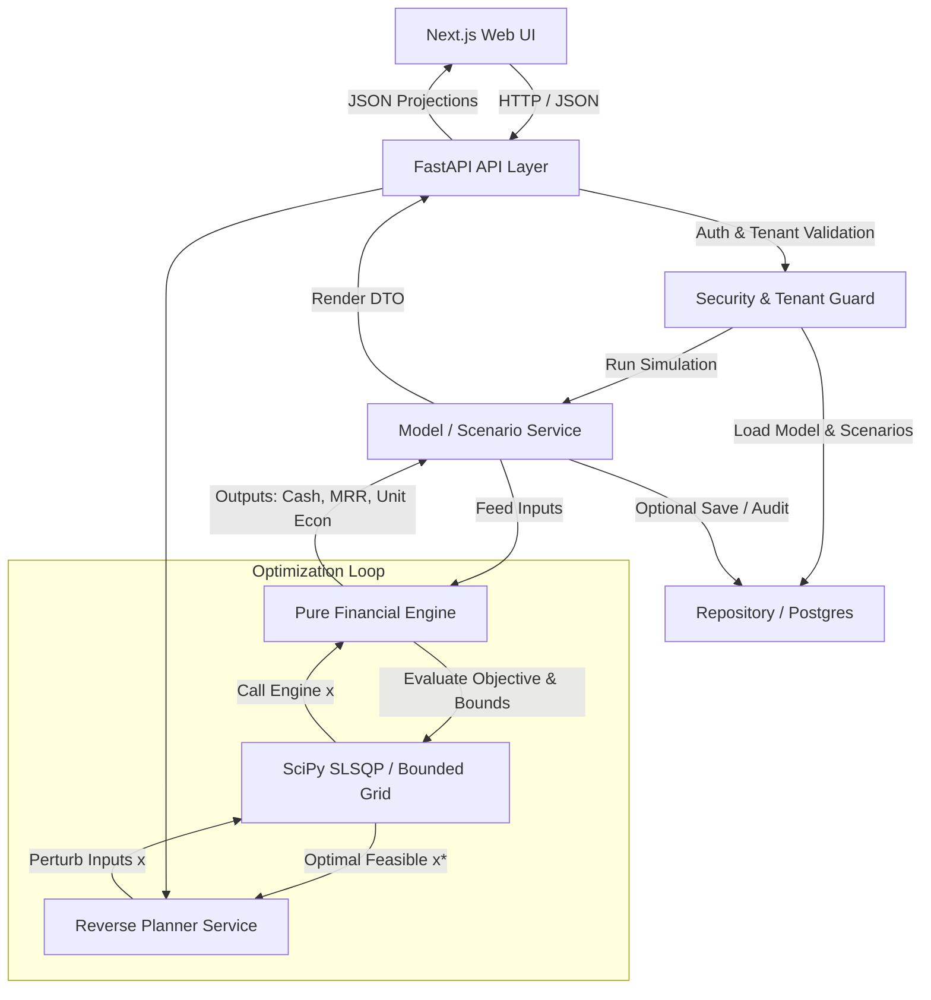

# VentureIQ: System Architecture

## 1. System Overview

VentureIQ is organized as a modular monorepo cleanly decoupling the user interface, API services, database persistence, and deterministic financial calculation logic.

```
VentureIQ/
├── apps/
│   └── web/                   # Next.js 15+ (React 19 / TypeScript / Tailwind CSS / Recharts)
├── services/
│   └── api/                   # Python 3.12+ / FastAPI / Pydantic / SQLAlchemy / SciPy
│       ├── app/
│       │   ├── api/           # HTTP Endpoints & Route Handlers
│       │   ├── core/          # Config, Security, Middleware, Database Session
│       │   ├── engine/        # PURE FINANCIAL ENGINE (Zero DB/HTTP dependencies)
│       │   ├── models/        # SQLAlchemy ORM Models
│       │   ├── schemas/       # Pydantic v2 Request/Response Data Transfer Objects
│       │   ├── services/      # Business logic orchestration (Scenario, Optimization, Sensitivity)
│       │   └── repositories/  # Data Access Layer & Tenant Scoping
│       ├── migrations/        # Alembic Schema Migrations
│       └── tests/             # Pytest Unit, Integration, & Reconciliation Tests
└── docs/                      # Architectural, Formula, & Operational Documentation
```

---

## 2. Purity of the Financial Engine

A critical design requirement is that **`app/engine/` has zero dependencies on web frameworks or databases**.
- It accepts plain Pydantic models / dataclasses or standard Python dictionaries/lists.
- It returns structured calculation outputs.
- It is 100% deterministic and unit testable in microseconds.
- Both the FastAPI API routes and the SciPy constrained optimization solver call this exact same engine.



---

## 3. Technology Stack Justifications

| Component | Technology | Rationale |
| :--- | :--- | :--- |
| **Frontend Framework** | Next.js (App Router), React, TypeScript | SSR/SSG capabilities, robust typed forms, fast rendering, modern developer ergonomics. |
| **Styling & UI** | Tailwind CSS & Accessible React UI | Fluid responsive design, rapid layout composing, accessible financial data inputs. |
| **Data Visualizations** | Recharts | Composable SVG-based charts with high performance for monthly financial timelines & comparisons. |
| **Backend Framework** | FastAPI (Python 3.12/3.14) | High throughput, native async support, automated OpenAPI docs generation. |
| **Data Validation** | Pydantic v2 | Extremely fast Rust-backed validation and serialization with strict numeric bounds. |
| **Database & ORM** | PostgreSQL 16+ & SQLAlchemy 2.0 | Normalized relational schema with strict foreign keys, multi-tenant indices, and ACID guarantees. |
| **Schema Migrations** | Alembic | Version-controlled, reproducible database schema management. |
| **Optimization Solver** | SciPy (`scipy.optimize`) & bounded search | Robust, deterministic numerical optimization algorithms (`SLSQP`, `minimize`, bounded Brent). |
| **Report Generation** | ReportLab & native CSV streams | High-performance server-side PDF generation and streaming CSV exports. |
| **Testing** | Pytest (Backend) & Vitest (Frontend) | Fast execution, fixture management, parameterized formula testing, high coverage. |

---

## 4. Multi-Tenant Security & Isolation Model

1. **User & Organization Hierarchy:**
   - Every User belongs to one or more Organizations (`OrganizationMember` with roles `owner`, `admin`, `member`, `viewer`).
   - Every `FinancialModel` is explicitly foreign-keyed to an `organization_id`.
2. **Mandatory Tenant Scoping in Repositories:**
   - Every database query for models, scenarios, inputs, and outputs filters by `organization_id` derived from the verified JWT bearer token.
   - Changing a model ID in the URL for an unauthorized tenant returns an immediate `404 Not Found` or `403 Forbidden`.
3. **Audit Trail:**
   - Changes to model configurations and assumptions create audit log entries (`audit_events`) capturing user ID, timestamp, and modification delta.

---

## 5. Reverse Planning Architecture

The reverse planning module operates as follows:
1. **Target Specification:** User defines a goal ($R^* = \text{₹1 Crore ARR at month 12}$) with cash constraints ($\text{Minimum Reserve} \ge \text{₹10 Lakh}$, $\text{Max Budget} \le \text{₹25 Lakh}$).
2. **Decision Variables & Bounds:** The user selects adjustable variables with lower and upper limits $[l_i, u_i]$:
   - Price: $[₹1,500, \, ₹5,000]$
   - Lead Conversion: $[2.0\%, \, 8.0\%]$
   - Monthly Churn: $[1.5\%, \, 5.0\%]$
   - Monthly Marketing Budget: $[₹1,00,000, \, ₹3,50,000]$
3. **Mathematical Solver:**
   - Converts the simulation into a minimization problem minimizing distance from target and capital consumption.
   - Evaluates simulation runs deterministically.
   - Checks feasibility: If no feasible combination exists within bounds, analyzes boundary projections to report the exact bottleneck (e.g. *Conversion capped at 8% yields max ARR ₹68L, short of ₹1.0Cr*).
4. **Independent Engine Verification:** The proposed optimal assumption set $\mathbf{x}^*$ is fed through the standard financial engine to verify zero constraint violations before returning to the client.
