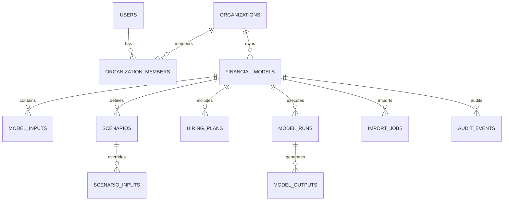

# VentureIQ: Relational Data Model Specification

## 1. Entity-Relationship Overview

VentureIQ uses PostgreSQL with foreign keys and strict tenant scoping.

---

## 2. Table Specifications

### 2.1 `users`
| Column | Type | Constraints | Description |
| :--- | :--- | :--- | :--- |
| `id` | UUID | PRIMARY KEY, default uuid_generate_v4() | Unique user identifier |
| `email` | VARCHAR(255) | UNIQUE, NOT NULL, INDEX | Verified email address |
| `hashed_password` | VARCHAR(255) | NOT NULL | Password hash (Argon2 / bcrypt) |
| `full_name` | VARCHAR(255) | NOT NULL | Display name |
| `is_active` | BOOLEAN | DEFAULT TRUE, NOT NULL | Account active status |
| `is_superuser` | BOOLEAN | DEFAULT FALSE, NOT NULL | Administrative privilege |
| `created_at` | TIMESTAMPTZ | DEFAULT NOW(), NOT NULL | Timestamp |
| `updated_at` | TIMESTAMPTZ | DEFAULT NOW(), NOT NULL | Timestamp |

### 2.2 `organizations`
| Column | Type | Constraints | Description |
| :--- | :--- | :--- | :--- |
| `id` | UUID | PRIMARY KEY | Workspace identifier |
| `name` | VARCHAR(255) | NOT NULL | Company / Organization name |
| `slug` | VARCHAR(255) | UNIQUE, NOT NULL | URL-friendly unique slug |
| `created_at` | TIMESTAMPTZ | DEFAULT NOW(), NOT NULL | Timestamp |

### 2.3 `organization_members`
| Column | Type | Constraints | Description |
| :--- | :--- | :--- | :--- |
| `id` | UUID | PRIMARY KEY | Membership record ID |
| `organization_id`| UUID | FK -> organizations(id) ON DELETE CASCADE | Scoped organization |
| `user_id` | UUID | FK -> users(id) ON DELETE CASCADE | Scoped user |
| `role` | VARCHAR(50) | NOT NULL, DEFAULT 'owner' | 'owner', 'admin', 'member', 'viewer' |
| `created_at` | TIMESTAMPTZ | DEFAULT NOW(), NOT NULL | Membership creation date |

*Constraint:* UNIQUE(`organization_id`, `user_id`)

### 2.4 `financial_models`
| Column | Type | Constraints | Description |
| :--- | :--- | :--- | :--- |
| `id` | UUID | PRIMARY KEY | Model identifier |
| `organization_id`| UUID | FK -> organizations(id) ON DELETE CASCADE | Owning organization |
| `name` | VARCHAR(255) | NOT NULL | Name of financial model |
| `business_model` | VARCHAR(50) | NOT NULL, DEFAULT 'b2b_saas' | 'b2b_saas', 'b2c_subscription', etc. |
| `currency` | VARCHAR(10) | NOT NULL, DEFAULT 'INR' | 'INR', 'USD', 'EUR', 'GBP' |
| `start_date` | VARCHAR(7) | NOT NULL, DEFAULT '2026-01' | Planning start period (YYYY-MM) |
| `planning_horizon`| INTEGER | NOT NULL, DEFAULT 12 | Horizon length in months (12..36) |
| `description` | TEXT | NULLABLE | Model context / assumptions notes |
| `created_at` | TIMESTAMPTZ | DEFAULT NOW(), NOT NULL | Timestamp |
| `updated_at` | TIMESTAMPTZ | DEFAULT NOW(), NOT NULL | Timestamp |

### 2.5 `model_inputs`
Stores classified baseline assumptions and observed facts.
| Column | Type | Constraints | Description |
| :--- | :--- | :--- | :--- |
| `id` | UUID | PRIMARY KEY | Input identifier |
| `model_id` | UUID | FK -> financial_models(id) ON DELETE CASCADE | Associated model |
| `category` | VARCHAR(50) | NOT NULL | 'OBSERVED_DATA', 'USER_ASSUMPTION', 'MODEL_OUTPUT' |
| `section` | VARCHAR(50) | NOT NULL | 'general', 'revenue', 'acquisition', 'retention', 'cogs', 'opex' |
| `key_name` | VARCHAR(100) | NOT NULL | Parameter identifier (e.g. `arpu`, `churn_rate`) |
| `value` | NUMERIC(18, 4)| NOT NULL | Numerical value |
| `unit` | VARCHAR(30) | NOT NULL | 'currency', 'percentage', 'count', 'ratio' |
| `period` | VARCHAR(7) | NULLABLE | Specific month (YYYY-MM) or NULL for all |
| `source` | VARCHAR(100) | DEFAULT 'user_entry' | Source (e.g. 'Stripe Import', 'Google Ads', 'Estimate') |
| `notes` | TEXT | NULLABLE | Documentation for the assumption |
| `updated_at` | TIMESTAMPTZ | DEFAULT NOW(), NOT NULL | Last modified timestamp |

### 2.6 `scenarios`
| Column | Type | Constraints | Description |
| :--- | :--- | :--- | :--- |
| `id` | UUID | PRIMARY KEY | Scenario identifier |
| `model_id` | UUID | FK -> financial_models(id) ON DELETE CASCADE | Associated model |
| `name` | VARCHAR(100) | NOT NULL | Scenario title (e.g. 'Base Case', 'Optimistic') |
| `scenario_type` | VARCHAR(50) | NOT NULL | 'base', 'optimistic', 'downside', 'custom' |
| `description` | TEXT | NULLABLE | Hypothesis description |
| `created_at` | TIMESTAMPTZ | DEFAULT NOW(), NOT NULL | Timestamp |

### 2.7 `scenario_inputs`
Overrides baseline inputs for a specific scenario.
| Column | Type | Constraints | Description |
| :--- | :--- | :--- | :--- |
| `id` | UUID | PRIMARY KEY | Scenario input identifier |
| `scenario_id` | UUID | FK -> scenarios(id) ON DELETE CASCADE | Associated scenario |
| `key_name` | VARCHAR(100) | NOT NULL | Parameter identifier being overridden |
| `value` | NUMERIC(18, 4)| NOT NULL | Overridden value |
| `notes` | TEXT | NULLABLE | Rationale for scenario modification |

### 2.8 `hiring_plans`
| Column | Type | Constraints | Description |
| :--- | :--- | :--- | :--- |
| `id` | UUID | PRIMARY KEY | Headcount record ID |
| `model_id` | UUID | FK -> financial_models(id) ON DELETE CASCADE | Associated model |
| `role_title` | VARCHAR(150) | NOT NULL | Job role title (e.g. 'Lead Engineer') |
| `department` | VARCHAR(100) | NOT NULL | 'Engineering', 'Sales', 'Marketing', 'G&A' |
| `headcount` | INTEGER | NOT NULL, DEFAULT 1 | Number of hires for this role |
| `monthly_salary`| NUMERIC(15, 2)| NOT NULL | Base monthly salary per employee |
| `employer_burden_rate` | NUMERIC(6, 4)| DEFAULT 0.15 | Taxes, PF, insurance % (e.g. 0.15 = 15%) |
| `start_month` | INTEGER | NOT NULL, DEFAULT 1 | Month number (1 to planning_horizon) hire begins |
| `annual_increase_rate` | NUMERIC(6, 4)| DEFAULT 0.05 | Annual appraisal increase rate (e.g. 0.05 = 5%) |

### 2.9 `model_runs` & `model_outputs`
- `model_runs` records the execution metadata: engine version, scenario ID, execution timestamp, and status.
- `model_outputs` stores the deterministic monthly calculated array (Customers, MRR, ARR, Cash, Burn, Margins, Runway) for fast lookup and reporting.

### 2.10 `import_jobs`
Tracks CSV imports, column mapping, validation status, error rows, and replacement confirmation.

### 2.11 `audit_events`
Records actions: user ID, model ID, action (`CREATED`, `MODIFIED_INPUT`, `DELETED_SCENARIO`), and JSON payload of change.
